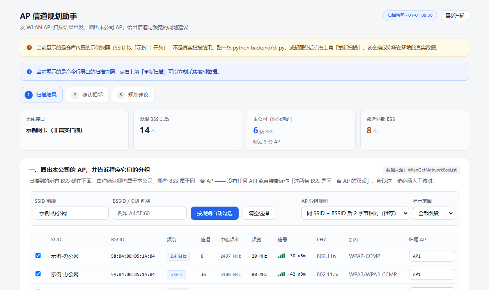
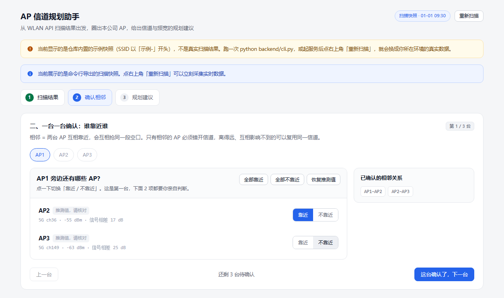
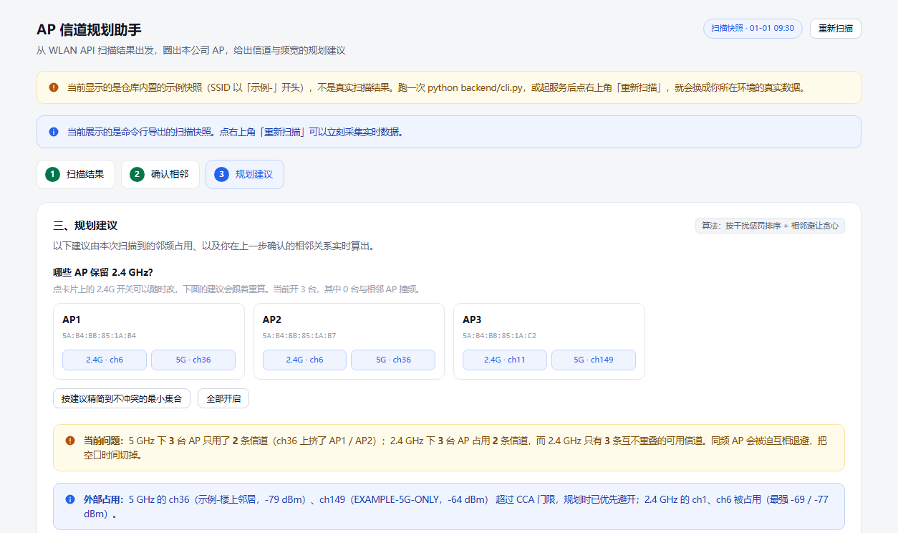
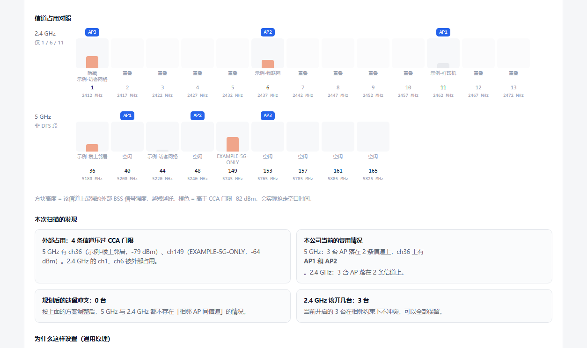
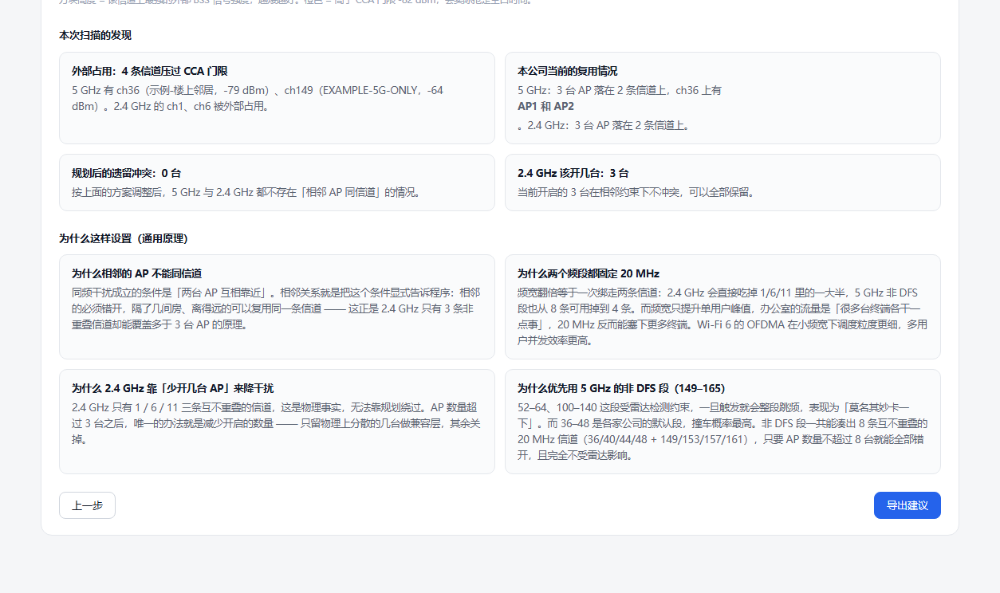

<div align="center">

# AP 信道规划助手

**用 Windows 原生 API 读取真实的 Wi-Fi 环境，一步步算出办公室的 AP 该用哪些信道。**

[](LICENSE)
[](#环境要求)
[](#环境要求)
[](#技术选型)

</div>

办公室 Wi-Fi 卡顿，多数时候不是设备不行，而是**信道撞了**。2.4 GHz 在中国只有
1 / 6 / 11 三条互不重叠的信道，AP 一多就只能互相退避 —— 这是物理限制，靠加钱买设备
绕不过去，只能靠规划。

这个工具把「规划」变成一件有依据的事：

- **真实扫描** —— 走 Windows 原生 `wlanapi.dll`，不是示例数据，也不需要抓包网卡
- **认出同一台 AP** —— 一台 AP 的 2.4G / 5G 是两条不同的 BSSID，按尾部字节合并成一台
- **确认相邻关系** —— 由你逐台确认哪些 AP 挨得近（相邻的必须错开信道）
- **给出建议** —— 结合外部同频占用，输出信道与频宽建议，**每条结论都附带依据**

<div align="center">
  
  <br><sub>第一步：把真实扫到的 BSS 按「本公司 / 外部」分开，并认出哪些属于同一台 AP</sub>
</div>

---

## 目录

- [三步工作流](#三步工作流)
- [功能特性](#功能特性)
- [截图](#截图)
- [快速开始](#快速开始)
- [工作原理](#工作原理)
- [项目结构](#项目结构)
- [开发指南](#开发指南)
- [HTTP 接口](#http-接口)
- [常见问题](#常见问题)
- [变更记录](#变更记录)
- [许可证](#许可证)

---

## 三步工作流

页面分成三步，每一步的结论都会流到下一步。

### 第一步 · 扫描结果

把本机扫到的所有 BSS 列成表。默认按「当前连着的 SSID」把本公司的 BSS 圈出来，
并猜测哪些 BSS 属于同一台 AP 的两个频段（这个猜测可以逐条改）。

### 第二步 · 确认相邻

一台一台问：这两个 AP 挨得近吗？**相邻的 AP 必须错开信道**，隔了几间房、离得远的
就可以复用同一条信道 —— 这正是 2.4 GHz 只有三条非重叠信道却能覆盖多于三台 AP 的原理。

不确定时的默认答案是「靠近」：报少了会让规划错误地复用同信道；报多了只会让规划更保守。

### 第三步 · 规划建议

结合「外部同频占用」和「你确认的相邻关系」，给出两个频段各自的信道与频宽建议，
并逐条写出依据。附一张频谱占用图，可以直接看出哪些信道已经被别人占住。

---

## 功能特性

- **真实数据，零第三方依赖** —— 后端只用 Python 标准库 + `ctypes`，`pip install` 一行都不需要
- **SSID 编码兼容** —— 按 UTF-8 → GB18030 依次尝试解码，兼容国内路由器和智能家电的 GBK 广播
- **双频自动合并** —— 同一台 AP 的 2.4G / 5G 是两条 BSSID，且差异可能出现在**中间字节**，
  默认按尾部 2 字节识别（规则可切换）
- **可解释的规划** —— 每条信道建议都写明：同频邻居是谁、多少 dBm、是否压过 CCA 门限
- **换机器也不会悄悄失败** —— 逐张网卡尝试、空结果重试、错误码原样带出
- **一键诊断** —— 在别的电脑上扫不到 Wi-Fi 时，`--diagnose` 打印每张网卡的状态与错误码
- **离线可测** —— 58 项页面逻辑断言 + 扫描回退测试，不需要真实无线网卡
- **便携打包** —— 内置 Python 嵌入式运行时，目标电脑不装 Python 也能双击运行

---

## 截图

| 第二步 · 确认相邻 | 第三步 · 规划结论 |
| --- | --- |
|  |  |

| 频谱占用图 | 本次扫描的发现 |
| --- | --- |
|  |  |

> 截图里的 SSID 形如 `示例-办公网`、`EXAMPLE-*`，是仓库内置的**示例快照**，
> 不是任何真实环境 —— 原因见[数据从哪来](#数据从哪来)。

---

## 快速开始

### 方式一 · 便携版（目标电脑不用装 Python）

```bat
python tools\build_portable.py
```

产出 `dist/ap-planner-portable.zip`，发给别人解压后双击 `start.bat` 即可 ——
会自动扫一次 Wi-Fi、起本地服务、打开浏览器。

### 方式二 · 源码运行（开发）

需要 Python 3.8+，不需要 pip 安装任何东西。

```bat
git clone <your-repo-url>
cd ap-planner

run_server.bat
```

`run_server.bat` 等价于下面这条，会先扫描一次再起服务并打开浏览器：

```bat
python backend\server.py --preload --open
```

只想导出一份离线快照、不起服务：

```bat
python backend\cli.py --table
```

之后直接双击 `frontend\index.html` 也能看到这批数据（页面走 `data/scan.js` 快照，
不依赖服务）。

---

## 工作原理

### 数据从哪来

全部走 Windows 原生 WLAN API，没有第三方依赖，也不需要 Wireshark 之类的抓包工具。

| 页面上的列 | 数据来源 |
| --- | --- |
| SSID | `WLAN_BSS_ENTRY.dot11Ssid` |
| BSSID | `WLAN_BSS_ENTRY.dot11Bssid` |
| 频段 | `ulChCenterFrequency` 换算（< 2500 → 2.4G，< 5925 → 5G，否则 6G） |
| 信道 | IE：DS Parameter Set(3) → HT Operation(61) → 中心频率换算 |
| 中心频率 | `ulChCenterFrequency`（kHz → MHz） |
| 频宽 | IE：VHT Operation(192) → HE PHY 能力(255/35) → HT Operation/Capabilities |
| 信号 | `WLAN_BSS_ENTRY.lRssi`（dBm） |
| PHY | IE 能力元素（EHT / HE / VHT / HT）与 `dot11BssPhyType` 取代际更高者 |
| 加密 | IE：RSN(48) → 厂商 WPA(221) → Capability.Privacy 推断 WEP |

调用的 API：`WlanOpenHandle` / `WlanEnumInterfaces` / `WlanScan` /
`WlanGetNetworkBssList` / `WlanQueryInterface` / `WlanRegisterNotification`。

扫描是异步的。后端注册 ACM 通知等「扫描完成」，而不是死等固定秒数；个别驱动不支持
通知时自动退化为定时等待。

> **关于「同一台 AP 的两个频段」**
>
> 一台 AP 的 2.4G 与 5G 是两条**不同的 BSSID**，差异甚至可能出现在中间字节。实测绘到的
> 一对就是这样：
>
> ```
> 2.4G  58:B4:BB:D5:1A:B4   ┐
> 5G    5A:B4:BB:85:1A:B4   ┘ 尾部都是 1A:B4
> ```
>
> 所以默认分组规则是「同 SSID + BSSID **后 2 字节**相同」，而不是按前 3 字节的 OUI ——
> 按 OUI 圈会把整片 2.4G 射频漏掉，看起来就像「每台 AP 只剩 5G」。

### 规划算法

**干扰代价 `penalty`** —— 把某信道上所有外部 BSS 的功率按 mW 线性相加，值越小越干净。

**贪心分配** —— 候选信道按干扰代价升序排，然后逐台 AP 取用：

1. 优先选「全公司还没用过」的信道（用得越少越靠前，让 AP 尽可能散开）
2. 硬约束：不能与**已分配的相邻 AP** 同信道
3. 实在无解才放宽，并在「依据」里明确写出这是妥协方案，不假装没问题

**2.4 GHz 精简** —— 三条非重叠信道塞不下更多 AP 时，在「相邻不同信道」的约束下穷举
求一个尽量大的可保留子集（≤ 18 台时精确求解，更大就保守地不精简）。同样大小的集合里
优先保留信号更强的那几台。

**频宽一律建议 20 MHz** —— 频宽翻倍等于一次绑走两条信道：2.4 GHz 会直接吃掉 1/6/11
里的一大半，5 GHz 非 DFS 段也从 8 条可用掉到 4 条。而频宽只提升单用户峰值，办公室的
流量是「很多台终端各干一点事」，20 MHz 反而塞得下更多终端；Wi-Fi 6 的 OFDMA 在小频宽下
调度粒度也更细。

**为什么优先用 5 GHz 非 DFS 段（149–165）** —— 52–64、100–140 这段受雷达检测约束，一旦
触发就整段跳频，表现为「莫名其妙卡一下」；而 36–48 是各家公司的默认段，撞车概率最高。
非 DFS 段一共能凑出 8 条互不重叠的 20 MHz 信道，AP 不超过 8 台就能全部错开，且完全不受
雷达影响。

### 技术选型

| 选择 | 理由 |
| --- | --- |
| Python 标准库 + `ctypes` | 后端零第三方依赖，拷到任何有 Python 的机器上都能跑 |
| 前端用普通 `<script>`，不用 ES module | 保证**双击 `index.html`**（`file://`）也能看到数据；只有起了服务才会发请求 |
| `http.server` 而不是 Flask | 同样是零依赖，静态托管 + 一个 `/api/scan` 足够 |
| 嵌入式 Python 发行包，而不是 PyInstaller | 体积小、启动快、不触发杀毒软件的「打包器」误报，文件全部可见 |

---

## 项目结构

```
ap-planner/
├─ backend/                     Python 后端（零第三方依赖）
│  ├─ wlanapi.py                wlanapi.dll 的 ctypes 绑定
│  ├─ ie_parser.py              802.11 信息元素解析
│  ├─ wlan_scanner.py           扫描编排 + 归一化成页面列
│  ├─ server.py                 本地 HTTP 服务（静态文件 + /api/scan）
│  └─ cli.py                    命令行扫描 / 导出快照 / --diagnose 诊断
│
├─ frontend/
│  ├─ index.html                页面结构
│  ├─ favicon.svg
│  ├─ css/style.css             全部样式
│  ├─ js/
│  │  ├─ config.js              规划算法常量（CCA 门限 / 信道表 / 分组规则）
│  │  ├─ store.js               全局状态与通用工具
│  │  ├─ scan-data.js           数据来源：快照 + 实时接口
│  │  ├─ step1-scan.js          第一步：扫描结果表与圈选分组
│  │  ├─ step2-adjacency.js     第二步：逐台确认相邻关系
│  │  ├─ step3-plan.js          第三步：规划计算与结果渲染
│  │  └─ app.js                 步骤切换 / 重新扫描 / 导出 / 启动
│  └─ data/
│     ├─ scan.js                扫描快照（供页面直接读取）
│     └─ scan.json              同一份数据的 JSON 版本
│
├─ tests/                       验证工具（开发用，不影响运行）
│  ├─ page-smoke-test.mjs       用 jsdom 跑页面逻辑，58 项断言
│  ├─ browser-check.mjs         用系统 Chrome 跑一遍并截图，采集控制台报错
│  ├─ inspect-spectrum.mjs      打印频谱图每个信道的实际渲染状态
│  ├─ server_ports_check.py     端口策略：重复启动 / 端口被别的程序占用
│  ├─ scanner_fallback_check.py 扫描回退：多网卡 / 权限被拒 / 周围真没 AP
│  └─ screenshots/              browser-check 的输出
│
├─ tools/                       打包相关（开发用）
│  ├─ build_portable.py         生成 dist/ 下的便携版文件夹与 zip
│  └─ check_portable.py         便携版冒烟测试：真跑一遍包里的运行时与服务
│
├─ run_server.bat               启动本地服务
├─ scan_once.bat                只扫描并导出快照
├─ package.json                 仅为前端测试声明 jsdom（非 Python 依赖）
└─ LICENSE                      MIT
```

`dist/`（打包产物）和 `.build/`（运行时下载缓存）可以随时删掉重新生成，
两者都已在 `.gitignore` 里。

### 关于 `frontend/data/`

`frontend/data/scan.js` 和 `scan.json` 是**示例快照**，SSID 形如 `示例-办公网`，
不包含任何真实环境的信息。它可以让你克隆下来直接双击 `index.html` 就看到一个填满的页面。

**跑一次 `python backend/cli.py` 就会用你自己的真实扫描结果覆盖它。** 提交前请留意
这一点 —— 真实快照里有你周围的 SSID 和 BSSID，在定位层面是有信息量的。

---

## 开发指南

### 环境要求

- **Windows 10 / 11**，Wi-Fi 已开启（后端硬依赖 `wlanapi.dll`，其它系统跑不了）
- **Python 3.8+**，只用到标准库，无需 `pip install`
- **Node 18+**（可选，只有前端测试需要）
- 若提示 `WlanSvc 服务未启动`，请在「服务」里启动 WLAN AutoConfig
- 若提示 `访问被拒绝（错误码 5）`，见[常见问题](#常见问题)

### 常用命令

```bat
:: 起服务（默认 127.0.0.1:8765，端口被占会自动往后找）
python backend\server.py
python backend\server.py --port 9000 --preload --open

:: 扫描并写入 frontend/data/ 下的快照
python backend\cli.py
python backend\cli.py --table           :: 顺便打印一张表
python backend\cli.py --json-only       :: 只输出 JSON，不写文件
python backend\cli.py --diagnose        :: 诊断：网卡清单 + 每一步的调用结果（不写文件）
```

### 测试

后端零依赖这一点让测试很容易跑 —— 大部分检查甚至不需要无线网卡。

```bat
npm install jsdom                          :: 只有前端测试需要

node tests\page-smoke-test.mjs             :: 页面逻辑 + 规划算法，58 项断言
node tests\browser-check.mjs               :: 真实浏览器渲染 + 控制台检查
node tests\inspect-spectrum.mjs            :: 频谱图逐信道状态
python tests\server_ports_check.py         :: 端口策略（7 项）
python tests\scanner_fallback_check.py     :: 扫描回退（19 项，用假的 wlanapi 替身）
```

几点说明：

- `browser-check.mjs` 调用**系统已装的 Chrome / Edge**，不额外下载 Chromium；截图默认写到
  `tests/screenshots/`。加 `--select` 会在截图前先应用一次默认筛选，让截图反映实际使用状态。
- `browser-check.mjs --url http://127.0.0.1:8765/` 可以打到本地服务上，顺便验证「页面由
  `http:` 提供时会自动拉一次实时数据」这条路径。
- `scanner_fallback_check.py` 用假的 `wlanapi` 替身跑，**不需要无线网卡**，专门盯「换到
  别的电脑上才会暴露」的几种局面（多网卡、位置权限被拒、周围确实没有 AP）。
- 打包完建议跑一遍 `python tools\check_portable.py`，它会真的解压 zip、起服务、扫一次 Wi-Fi。

### 打包便携版

```bat
python tools\build_portable.py
python tools\check_portable.py --from-zip   :: 解压真 zip 再验一遍
```

运行时压缩包缓存在 `.build/`，重复构建不会再下载。

### 二次开发时请先读这几条约定

这几条都是踩过坑总结出来的，改动前建议先看一眼原因：

1. **后端保持零第三方依赖。** 只用标准库 + `ctypes`。一旦引入需要 `pip install` 的包，
   嵌入式运行时（没有 pip / site-packages）就跑不起来了。
2. **前端用普通 `<script>`，不要换成 ES module。** 当前所有 JS 共享同一个全局作用域，
   按 `index.html` 里的顺序加载。改成 `type="module"` 会让 `file://` 直开直接失效
   （模块请求受 CORS 限制），而「双击 `index.html` 也能看数据」是这个项目的硬性要求。
3. **`.bat` 里绝不能出现中文。** `cmd.exe` 在 UTF-8 代码页下读批处理会丢同步，把中文行的
   后半截当成命令执行，窗口里冒出一串「不是内部或外部命令」。所有中文提示交给 Python 打印，
   批处理保持**纯 ASCII + CRLF**（`.gitattributes` 已保证检出为 CRLF）。
4. **后端输出的字段 = 页面表格的列，一个不多一个不少。** 加字段请连页面一起改，
   否则会出现「后端有、页面没有」的静默不一致。
5. **别把「扫描失败」写成「没有 AP」。** 两者对用户的意义完全不同：所有网卡硬失败要返回
   `ok=false` + 具体错误码，扫描成功但确实没 AP 才返回 `ok=true` + 警告。
   这条被 `tests/scanner_fallback_check.py` 钉住了，改之前先看那个测试。
6. **别在断言里依赖现场 Wi-Fi。** `frontend/data/scan.json` 是真实环境快照，会变。
   需要验「双频行为」这类断言时，用 `applyScanPayload` 灌一份构造数据，
   现场快照只适合做包含关系检查。
7. **删除任何改动前先跑测试。** `page-smoke-test.mjs` + `scanner_fallback_check.py`
   加起来覆盖了大部分回归面，跑一次只要几秒。

---

## HTTP 接口

服务只监听 `127.0.0.1`，局域网内其它机器访问不到，扫描数据不出本机。

| 路径 | 说明 |
| --- | --- |
| `GET /` | 页面本身（静态托管 `frontend/`） |
| `GET /api/ping` | 探活，前端用它判断服务在不在 |
| `GET /api/scan` | 重新扫描一次（约 2–10 秒） |
| `GET /api/scan?fresh=0` | 直接返回上一次扫描结果，不重新扫描 |
| `GET /api/scan?write=1` | 扫描完顺便刷新 `frontend/data/` 下的快照 |

扫描结果的 JSON 结构：

```jsonc
{
  "ok": true,
  "scanned_at": "2026-09-20T15:02:11+08:00",
  "interface": {
    "name": "Realtek RTL8852BE WiFi 6 802.11ax PCIe Adapter",
    "state": "已连接",
    "current_ssid": "CorpWiFi",
    "current_bssid": "A4:5E:60:01:01:00"
  },
  "warnings": [],
  "bss": [
    {
      "ssid": "CorpWiFi", "bssid": "A4:5E:60:01:01:00",
      "band": "5", "channel": 36, "frequency": 5180, "width": 20,
      "rssi": -42, "phy": "802.11ax", "security": "WPA2/WPA3-CCMP"
    }
  ]
}
```

失败时 `ok` 为 `false`、`bss` 为空数组，并多一个 `error` 字段（例如位置权限不足时的
错误码 5 提示）。

---

## 常见问题

### 换台电脑就扫不到 Wi-Fi

先查**位置权限**，这几乎总是真正的原因。

微软从 2023 年起把 Wi-Fi 扫描纳入了**位置隐私管控**：调用方没有「精确位置」权限时，
下面这些 API 一律返回 `ERROR_ACCESS_DENIED(5)`。

```
WlanScan                          ← 触发扫描
WlanGetNetworkBssList             ← 读 BSS 列表
WlanGetAvailableNetworkList
WlanQueryInterface(current_connection)
```

解决方式：**设置 → 隐私和安全性 → 位置**，先打开「定位服务」，再在应用列表里允许本程序
访问位置，然后重新扫描。

> **以管理员身份运行没有用。** 挡路的不是权限等级，而是隐私授权。连
> `netsh wlan show networks` 都会直接提示需要位置权限。
>
> [微软官方说明](https://learn.microsoft.com/windows/win32/nativewifi/wi-fi-access-location-changes)

为什么一个「扫描 Wi-Fi」的 API 会归到位置权限？因为**扫描结果本身就是位置数据**：
每个 BSSID 都在 Wi-Fi 定位数据库里有登记的坐标，扫到三个以上就能反推出你在哪（精度
10–20 米，室内比 GPS 还准）。所以操作系统只能按「能不能定位」来管，无法区分调用方的意图。

如果位置权限确认没问题还是扫不到，按顺序再查：

1. Wi-Fi 是不是开着（飞行模式、Fn 快捷键关掉射频、网卡被禁用）
2. `WLAN AutoConfig`（WlanSvc）服务有没有在运行

还是不行就跑诊断，把输出整段发回来：

```bat
python backend\cli.py --diagnose
```

它会打印枚举到的每张网卡（描述 / 状态 / GUID）、每一步调用的结果与错误码，以及对应的
处理建议。这个命令**不写文件**，纯输出。

### 页面打开是空白的

页面由本地服务提供时，确认黑窗口还开着。用 `file://` 直接双击 `index.html` 打开时，
读的是 `frontend/data/scan.js` —— 如果那份快照是空的，页面就会是空的，
跑一次 `python backend\cli.py` 即可。

### 为什么页面不自动重新扫描

`file://` 直开时不发任何请求，这是刻意的：保证双击就能看数据，也避免在没有服务时
在控制台刷一堆失败请求。想要实时数据就起服务，页面加载后会自己拉一次
`/api/scan?fresh=0`。

---

## 变更记录

见 [CHANGELOG.md](CHANGELOG.md)。

---

## 许可证

[MIT](LICENSE) © 2026 ap-planner contributors
。
